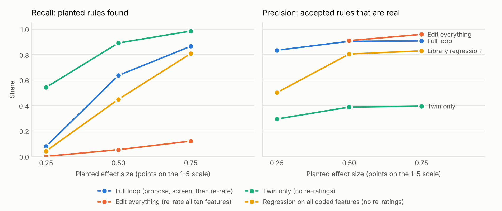
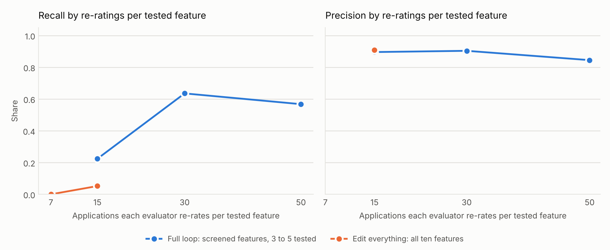

# Planted-rule benchmark: results

12 replications per cell (benchmark seeds 100 to 111, disjoint from the seeds used in development and tests). Each replication draws 156 synthetic applications and a panel of 20 synthetic evaluators (10 women, 10 men). Every evaluator shares four reactions (paying customers +0.30, fluent English +0.15, five or more years of experience +0.15, solo founder -0.15, each varying by evaluator with SD 0.10); 14 of the 20 also carry planted rules of the stated effect size. Re-ratings carry fresh noise: an evaluator's reading of a venture on the second occasion correlates rho = 0.6 with the first (test-retest correlation of ratings about 0.7). A rule counts as found only if the method reports the planted feature in the planted direction; shared reactions reported as an evaluator's own rule count as false. Main design: the loop re-rates up to five screened features, 30 applications each, so 150 re-ratings per evaluator; edit everything spreads the same budget over all ten features (15 applications each); no evaluator re-rates an application twice.

## Rule recovery

Pooled over evaluators and replications; standard errors across replications in parentheses.

| Method                    |   Effect size | Precision (SE)          | Recall (SE)   |   Evaluators exactly right |   Null evaluators given a rule |   Re-ratings per evaluator |
|:--------------------------|--------------:|:------------------------|:--------------|---------------------------:|-------------------------------:|---------------------------:|
| Full loop                 |          0.25 | 0.83 (0.12)             | 0.08 (0.03)   |                       0.34 |                           0.03 |                     146.17 |
| Loop, total-reaction test |          0.25 | 0.53 (0.07)             | 0.12 (0.03)   |                       0.34 |                           0.11 |                     146.17 |
| Edit everything           |          0.25 | n/a (no rules accepted) | 0.00 (0.00)   |                       0.30 |                           0.00 |                     149.67 |
| Twin only                 |          0.25 | 0.29 (0.02)             | 0.54 (0.03)   |                       0.20 |                           0.65 |                       0.00 |
| Screen only               |          0.25 | 0.34 (0.03)             | 0.31 (0.03)   |                       0.30 |                           0.39 |                       0.00 |
| Library regression        |          0.25 | 0.50 (0.16)             | 0.04 (0.01)   |                       0.31 |                           0.06 |                       0.00 |
| Coded covariates          |          0.25 | 0.62 (0.12)             | 0.08 (0.03)   |                       0.33 |                           0.07 |                       0.00 |
| Full loop                 |          0.50 | 0.90 (0.03)             | 0.64 (0.04)   |                       0.69 |                           0.07 |                     145.92 |
| Loop, total-reaction test |          0.50 | 0.87 (0.03)             | 0.66 (0.04)   |                       0.68 |                           0.14 |                     145.92 |
| Edit everything           |          0.50 | 0.91 (0.08)             | 0.05 (0.02)   |                       0.34 |                           0.00 |                     149.67 |
| Twin only                 |          0.50 | 0.39 (0.02)             | 0.89 (0.02)   |                       0.30 |                           0.67 |                       0.00 |
| Screen only               |          0.50 | 0.51 (0.03)             | 0.77 (0.03)   |                       0.46 |                           0.39 |                       0.00 |
| Library regression        |          0.50 | 0.80 (0.03)             | 0.45 (0.03)   |                       0.55 |                           0.12 |                       0.00 |
| Coded covariates          |          0.50 | 0.74 (0.05)             | 0.33 (0.03)   |                       0.44 |                           0.11 |                       0.00 |
| Full loop                 |          0.75 | 0.91 (0.02)             | 0.86 (0.03)   |                       0.82 |                           0.10 |                     147.00 |
| Loop, total-reaction test |          0.75 | 0.91 (0.02)             | 0.89 (0.02)   |                       0.84 |                           0.11 |                     147.00 |
| Edit everything           |          0.75 | 0.96 (0.03)             | 0.12 (0.03)   |                       0.38 |                           0.01 |                     149.67 |
| Twin only                 |          0.75 | 0.39 (0.01)             | 0.98 (0.01)   |                       0.24 |                           0.72 |                       0.00 |
| Screen only               |          0.75 | 0.51 (0.02)             | 0.94 (0.02)   |                       0.46 |                           0.44 |                       0.00 |
| Library regression        |          0.75 | 0.83 (0.03)             | 0.81 (0.03)   |                       0.74 |                           0.15 |                       0.00 |
| Coded covariates          |          0.75 | 0.75 (0.04)             | 0.48 (0.01)   |                       0.53 |                           0.14 |                       0.00 |

## Re-ratings per tested feature (effect size 0.50)

With 156 applications and each re-rated at most once per evaluator, testing all ten features leaves at most 15 re-ratings per feature. Screening first lets the loop spend 30 to 50 on each feature it tests. Under realistic re-rating noise, the number of re-ratings per tested feature is what decides whether an individual evaluator's rule can be confirmed.

| Method          |   Re-ratings per tested feature |   Budget per evaluator |   Precision |   Recall |   Evaluators exactly right |   Null evaluators given a rule |
|:----------------|--------------------------------:|-----------------------:|------------:|---------:|---------------------------:|-------------------------------:|
| Full loop       |                              15 |                     75 |        0.90 |     0.22 |                       0.42 |                           0.03 |
| Full loop       |                              30 |                    150 |        0.90 |     0.64 |                       0.69 |                           0.07 |
| Full loop       |                              50 |                    150 |        0.84 |     0.57 |                       0.60 |                           0.08 |
| Edit everything |                               7 |                     75 |      nan    |     0.00 |                       0.30 |                           0.00 |
| Edit everything |                              15 |                    150 |        0.91 |     0.05 |                       0.34 |                           0.00 |

## Sensitivity to re-rating noise (effect size 0.50)

| Method             |   Test-retest correlation of evaluators' reading (rho) |   Precision |   Recall |   Null evaluators given a rule |
|:-------------------|-------------------------------------------------------:|------------:|---------:|-------------------------------:|
| Edit everything    |                                                   0.30 |        0.60 |     0.03 |                           0.01 |
| Edit everything    |                                                   0.60 |        0.91 |     0.05 |                           0.00 |
| Edit everything    |                                                   0.90 |        0.97 |     0.15 |                           0.00 |
| Library regression |                                                   0.30 |        0.80 |     0.45 |                           0.12 |
| Library regression |                                                   0.60 |        0.80 |     0.45 |                           0.12 |
| Library regression |                                                   0.90 |        0.80 |     0.45 |                           0.12 |
| Full loop          |                                                   0.30 |        0.91 |     0.51 |                           0.04 |
| Full loop          |                                                   0.60 |        0.90 |     0.64 |                           0.07 |
| Full loop          |                                                   0.90 |        0.85 |     0.74 |                           0.17 |

## Variants of the confirmation test (effect size 0.50)

The default test compares each evaluator's reaction with the panel median. One variant adds the estimated spread of reactions across evaluators to the standard error, so a rule must stand out from ordinary differences between evaluators. The other adds the evaluator's original residual as a covariate to remove regression to the mean from hypothesis selection; because that residual also contains the rule itself, it attenuates true effects.

| Confirmation test                      |   Precision |   Recall |   Evaluators exactly right |   Null evaluators given a rule |
|:---------------------------------------|------------:|---------:|---------------------------:|-------------------------------:|
| Full loop                              |        0.90 |     0.64 |                       0.69 |                           0.07 |
| Loop, test allows for evaluator spread |        0.95 |     0.47 |                       0.60 |                           0.01 |
| Loop, regression-to-mean covariate     |        0.96 |     0.50 |                       0.62 |                           0.03 |

## Recall by planted role (effect size 0.50)

| role       |   Full loop |   Loop, total-reaction test |   Edit everything |   Twin only |   Screen only |   Library regression |   Coded covariates |
|:-----------|------------:|----------------------------:|------------------:|------------:|--------------:|---------------------:|-------------------:|
| ability    |        0.50 |                        0.58 |              0.08 |        0.79 |          0.54 |                 0.25 |               0.00 |
| cue        |        0.83 |                        0.81 |              0.02 |        0.96 |          0.88 |                 0.50 |               0.62 |
| fluency    |        0.42 |                        0.42 |              0.08 |        0.88 |          0.79 |                 0.58 |               0.00 |
| multi      |        0.58 |                        0.65 |              0.02 |        0.83 |          0.73 |                 0.29 |               0.35 |
| proxy      |        0.75 |                        0.79 |              0.08 |        1.00 |          0.75 |                 0.71 |               0.71 |
| proxy_home |        0.58 |                        0.58 |              0.08 |        0.88 |          0.88 |                 0.46 |               0.00 |

## Locating the root of an apparent same-gender premium

Evaluators whose residual scores show a significant same-gender premium (p < 0.05) and whose premium has a planted root: a name-and-pronoun cue, or gender-correlated content (sector or home-based). "Root correct" means cue versus content is classified correctly. "Names the right feature" also requires the content feature itself to be identified, with no cue rule. The redaction battery can only say whether the premium runs through the cue.

| Method                    |   Effect size |   Evaluators with apparent premium |   Root (cue or content) correct |   Names the right feature |
|:--------------------------|--------------:|-----------------------------------:|--------------------------------:|--------------------------:|
| Full loop                 |          0.25 |                                 51 |                            0.18 |                      0.18 |
| Loop, total-reaction test |          0.25 |                                 51 |                            0.18 |                      0.18 |
| Edit everything           |          0.25 |                                 51 |                            0.00 |                      0.00 |
| Twin only                 |          0.25 |                                 51 |                            0.80 |                      0.65 |
| Library regression        |          0.25 |                                 51 |                            0.04 |                      0.04 |
| Coded covariates          |          0.25 |                                 51 |                            0.27 |                      0.27 |
| Redaction battery         |          0.25 |                                 51 |                            0.37 |                    nan    |
| Full loop                 |          0.50 |                                 85 |                            0.82 |                      0.82 |
| Loop, total-reaction test |          0.50 |                                 85 |                            0.82 |                      0.82 |
| Edit everything           |          0.50 |                                 85 |                            0.04 |                      0.04 |
| Twin only                 |          0.50 |                                 85 |                            0.86 |                      0.62 |
| Library regression        |          0.50 |                                 85 |                            0.54 |                      0.53 |
| Coded covariates          |          0.50 |                                 85 |                            0.61 |                      0.61 |
| Redaction battery         |          0.50 |                                 85 |                            0.66 |                    nan    |
| Full loop                 |          0.75 |                                100 |                            0.96 |                      0.93 |
| Loop, total-reaction test |          0.75 |                                100 |                            0.96 |                      0.94 |
| Edit everything           |          0.75 |                                100 |                            0.09 |                      0.09 |
| Twin only                 |          0.75 |                                100 |                            0.88 |                      0.60 |
| Library regression        |          0.75 |                                100 |                            0.91 |                      0.87 |
| Coded covariates          |          0.75 |                                100 |                            0.79 |                      0.78 |
| Redaction battery         |          0.75 |                                100 |                            0.89 |                    nan    |

## Effect estimates for correctly recovered rules

Estimates are conditional on the rule having been found, so small effects are overstated (only large draws pass), and large ones are slightly compressed by the 1 to 5 scale.

| Method                    |   Planted effect |   Mean estimate |   SD of estimate |   Rules |
|:--------------------------|-----------------:|----------------:|-----------------:|--------:|
| Edit everything           |             0.50 |            0.73 |             0.14 |      10 |
| Edit everything           |             0.75 |            0.85 |             0.14 |      23 |
| Library regression        |             0.25 |            0.41 |             0.05 |       8 |
| Library regression        |             0.50 |            0.49 |             0.10 |      86 |
| Library regression        |             0.75 |            0.58 |             0.14 |     155 |
| Full loop                 |             0.25 |            0.39 |             0.10 |      15 |
| Full loop                 |             0.50 |            0.48 |             0.10 |     122 |
| Full loop                 |             0.75 |            0.65 |             0.14 |     166 |
| Loop, total-reaction test |             0.25 |            0.44 |             0.15 |      24 |
| Loop, total-reaction test |             0.50 |            0.54 |             0.15 |     127 |
| Loop, total-reaction test |             0.75 |            0.73 |             0.17 |     170 |
| Screen only               |             0.25 |            0.18 |             0.07 |      59 |
| Screen only               |             0.50 |            0.28 |             0.11 |     148 |
| Screen only               |             0.75 |            0.42 |             0.17 |     180 |
| Twin only                 |             0.25 |            0.15 |             0.07 |     104 |
| Twin only                 |             0.50 |            0.21 |             0.10 |     171 |
| Twin only                 |             0.75 |            0.31 |             0.15 |     189 |

## Ability or bias (outcome test on correctly recovered rules)

A recovered rule is labelled ability if the rewarded feature predicts the outcome beyond the consensus score. In this world only paying customers carries such information, so the correct share is 1 for ability rules and 0 for bias rules. With 156 startups and noisy outcomes the test has little power.

|   Effect size | True type   |   Share labelled ability |   Rules |
|--------------:|:------------|-------------------------:|--------:|
|          0.25 | ability     |                     0.00 |       2 |
|          0.25 | bias        |                     0.08 |      13 |
|          0.50 | ability     |                     0.14 |      22 |
|          0.50 | bias        |                     0.07 |     100 |
|          0.75 | ability     |                     0.08 |      36 |
|          0.75 | bias        |                     0.07 |     130 |
